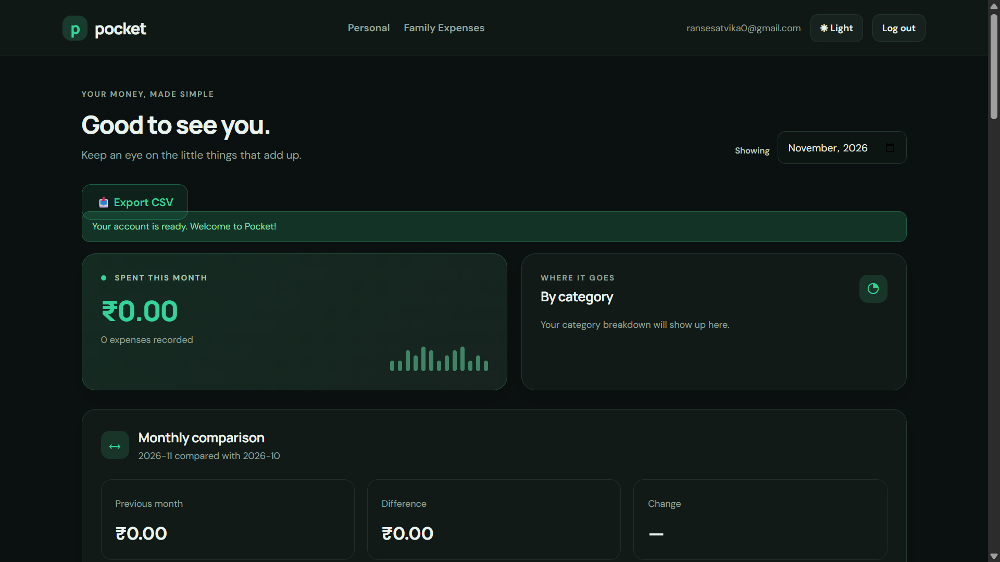
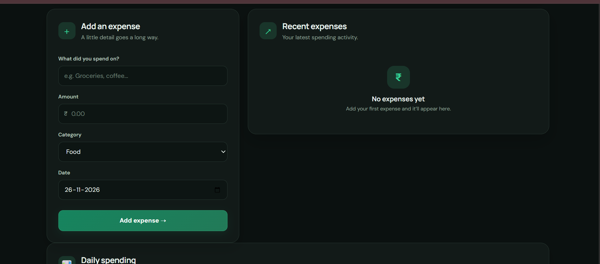
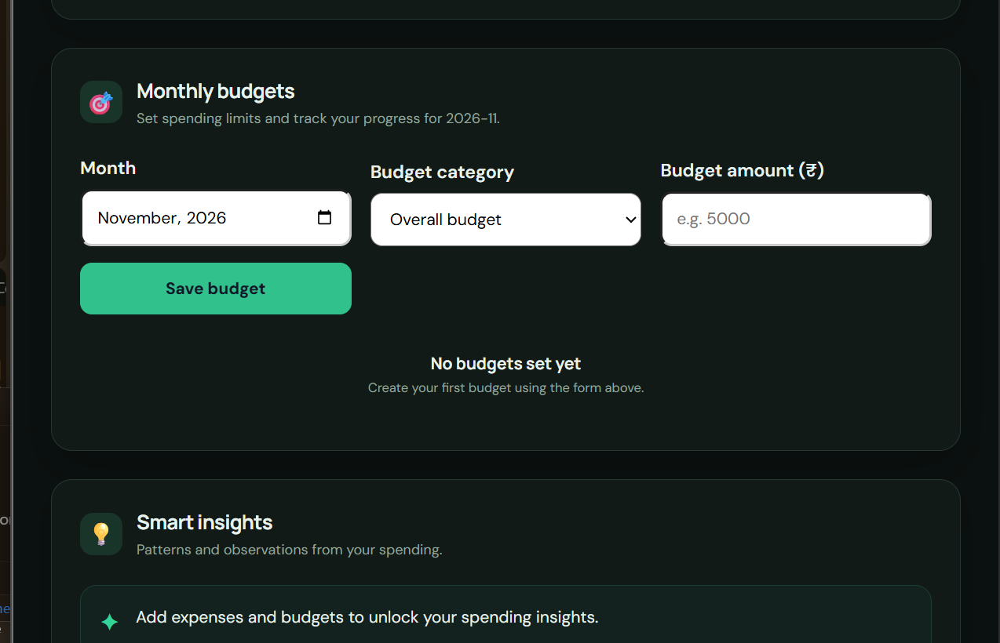

# 💰 Pocket Expense Tracker

A simple, secure, and personal expense tracker built with Flask. Track your expenses, manage your budget, and keep your financial records organized.

## 📸 Preview

### Dashboard


### Expenses


### Budget


🌐 **Live App:** https://pocket-expense-tracker-iy0z.onrender.com/

---

## ✨ Features

- 🔐 **User Authentication** — Individual accounts with email and password.
- 💸 **Expense Management** — Add, edit, and manage expenses.
- 📊 **Dashboard & Analytics** — Visualize and track your spending.
- 🎯 **Budget Management** — Organize expenses around your budget.
- 👥 **Account Data Isolation** — Personal expense data is restricted to the respective account.
- 📱 **Responsive Design** — Designed to work across different screen sizes.
- 📲 **Installable PWA** — Install Pocket on supported phones and computers.
- 📴 **Offline Page** — Includes an offline page for the installed application.

---

## 🛠️ Tech Stack

| Technology | Purpose |
|---|---|
| Python | Backend programming |
| Flask | Web framework |
| SQLite | Local database |
| PostgreSQL | Hosted database |
| Supabase | Hosted PostgreSQL database |
| HTML & CSS | Frontend |
| JavaScript | Frontend functionality |
| Render | Application hosting |

---

## 🚀 Run Locally

### 1. Clone the repository

```bash
git clone https://github.com/ranesatvika/pocket-expense-tracker.git
```

### 2. Navigate to the project folder

```bash
cd pocket-expense-tracker
```

### 3. Install dependencies

```bash
python -m pip install -r requirements.txt
```

### 4. Start the application

```bash
python app.py
```

### 5. Open in your browser

http://127.0.0.1:5000

Create an account to get started.

> Local data is stored in `expenses.db` when no `DATABASE_URL` is configured.

---

## ☁️ Deployment

Pocket uses Render for hosting and Supabase PostgreSQL for hosted database storage.

### Environment Variables

Configure the following variables in your Render service:

- `DATABASE_URL` — Supabase PostgreSQL connection string.
- `SECRET_KEY` — A unique, secure secret key.
- `OWNER_EMAIL` — Email address associated with the existing owner account.
- `OWNER_PASSWORD` — A unique password of at least 12 characters.

### Deployment Notes

- Back up the Supabase database before deploying database-related changes.
- Use the appropriate Supabase Session Pooler connection string for your Render setup.
- Existing expenses are assigned to the configured owner account during the relevant database initialization.
- Configure the owner credentials before deploying updates that require them.
- Keep all credentials and database connection details private.

---

## 📱 Install Pocket

Pocket is an installable Progressive Web App (PWA).

1. Open the hosted application in a supported browser.
2. Use the browser's **Install app** or **Add to Home Screen** option.
3. Open Pocket from your device like a regular application.

> An internet connection is required for the hosted application.

---

## 📂 Project Structure

```text
pocket-expense-tracker/
│
├── app.py
├── convert_icons.py
├── requirements.txt
├── Procfile
├── README.md
│
├── static/
│   ├── style.css
│   ├── service-worker.js
│   ├── manifest.webmanifest
│   └── icons/
│
└── templates/
    ├── index.html
    ├── login.html
    ├── register.html
    ├── edit_expense.html
    └── offline.html
```

---

## 🔒 Security

- Passwords are handled using secure password hashing.
- Account-based access restrictions are implemented.
- Secrets and database credentials should never be committed to GitHub.
- Database backups are recommended before schema updates.

---

## 👩‍💻 Author

**Satvika Rane**

GitHub: [@ranesatvika](https://github.com/ranesatvika)

---

⭐ If you find this project interesting, feel free to explore the repository!
